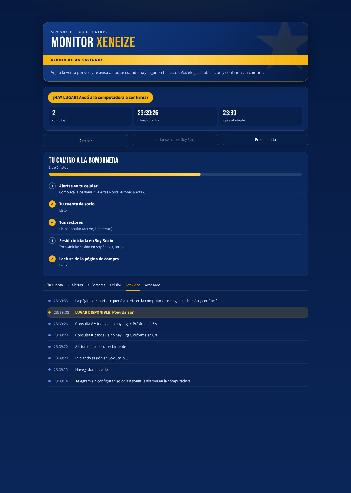

# Monitor Xeneize — alerta de ubicaciones en Soy Socio

Monitor personal que consulta la página de un partido en Soy Socio cada **5 a 7 segundos (al azar)** con tu propia sesión.
Cuando aparece una ubicación disponible:

1. deja **abierta la ventana del navegador, con tu sesión iniciada, en la página del partido**;
2. hace sonar una **alerta**;
3. te manda un **mensaje de Telegram** con el detalle y un botón para abrir el partido;
4. y **se detiene**. La reserva y el pago los hacés vos, con tus clics.



> **Uso responsable.** Es una herramienta para tu cuenta de socio y para uso personal. No reserva ni paga sola, no
> intenta saltear captchas ni bloqueos (si aparece uno, se pausa y te avisa) y no permite bajar de 5 s entre consultas.
> Revisá los términos y condiciones de Soy Socio: la automatización puede estar restringida y, si la usás, la
> responsabilidad sobre tu cuenta es tuya.

---

## 1. Requisitos

- Python **3.10 o superior** ([python.org](https://www.python.org/downloads/); en Windows, tildá *"Add Python to PATH"*).
- Google Chrome no hace falta: Playwright descarga su propio Chromium.

## 2. Instalación

### Fácil (doble clic)

- **Windows**: doble clic en `instalar.bat` (una sola vez) y después en `iniciar.bat` cada vez que quieras usar la app.
- **Mac / Linux**: en una terminal dentro de la carpeta, `bash instalar.sh` (una sola vez) y después `bash iniciar.sh`.

Si no tenés Python, el instalador te abre la página de descarga. La app queda en `http://localhost:8501`.

### Manual

```bash
git clone <url-de-este-repo> boost
cd boost

python -m venv .venv
# Windows:
.venv\Scripts\activate
# macOS / Linux:
source .venv/bin/activate

pip install -r requirements.txt
python -m playwright install chromium
```

## 3. Arrancar el panel

Doble clic en `iniciar` (o `streamlit run app.py`). Se abre en el navegador en `http://localhost:8501`.

**Todo se guarda solo** apenas escribís o elegís algo; no hay botón de guardar. Los datos de tu cuenta quedan en el
archivo `.env` y el resto en `config.yaml`, solo en tu computadora (los dos están en `.gitignore`).

La tarjeta **"Tu camino a la Bombonera"** muestra qué está listo y qué falta, con una barra de progreso.

## 4. Configuración paso a paso

### 4.1 Pestañas "1 · Tu cuenta" y "2 · Alertas"

- **Tu cuenta**: DNI y contraseña de Soy Socio. Son opcionales: si los cargás, la app vuelve a entrar sola cuando la
  sesión vence; si no, iniciás sesión a mano en la ventana que se abre.
- **Alertas** (Telegram, recomendado): la pestaña trae las instrucciones paso a paso en "¿Cómo consigo estos datos?".
  En resumen: creá un bot con **@BotFather** (`/newbot`), copiá el **token**, mandale "hola" a tu bot y pedile tu
  **chat_id** a **@userinfobot**. Después tocá **Probar alerta**.

### 4.2 Pestaña "Avanzado": cómo le decís al monitor qué mirar

La web de Soy Socio cambia con el tiempo, así que los "selectores" (cómo identificar cada elemento de la página) los
configurás vos con las herramientas de desarrollador del navegador. Se hace una sola vez:

1. Abrí Soy Socio en Chrome e iniciá sesión.
2. **Selector visible solo con sesión iniciada** (`login.logged_in_selector`): hacé clic derecho sobre algo que solo se ve
   logueado (tu nombre, "Mi cuenta", "Cerrar sesión") → **Inspeccionar**. En el panel de elementos, clic derecho sobre el
   nodo resaltado → **Copy → Copy selector**. Pegalo en el panel.
3. **Formulario de login**: con la sesión cerrada, hacé lo mismo sobre el campo DNI, el de contraseña y el botón
   "Ingresar". Los valores por defecto (`input[name='dni']`, etc.) son solo un punto de partida.
4. **URL del partido**: entrá a la compra del partido que te interesa y copiá la URL de la barra de direcciones.

Después elegí uno de los dos modos de detección:

#### Modo página (más simple)

- **Selector CSS de un sector disponible**: en la página del partido, inspeccioná un sector **con lugar** y buscá una
  clase o atributo que lo distinga de uno agotado (por ejemplo `.sector.disponible` o
  `[data-estado='disponible']`). Si en ese momento no hay ninguno disponible, compará cómo está marcado uno agotado e
  inferí la variante "disponible", o usá el modo API.
- **Selector de página cargada** (opcional): un elemento que siempre aparece al terminar de cargar (por ejemplo el
  contenedor del mapa del estadio). Hace la consulta más rápida y confiable.

Podés comprobar un selector en la consola de DevTools: `document.querySelectorAll("TU_SELECTOR").length`.

#### Modo API (más liviano, recomendado si está disponible)

1. Con DevTools abierto en la pestaña **Network**, filtro **Fetch/XHR**, recargá la página del partido.
2. Buscá el pedido que devuelve los sectores y su disponibilidad (en **Preview** se ve el JSON).
3. Copiá su URL (clic derecho → **Copy → Copy URL**) en **URL del JSON**.
4. Indicá dónde está la lista y qué campos usar. Por ejemplo, para este JSON:

   ```json
   { "data": { "sectores": [ { "nombre": "Platea Baja L", "disponibles": 4 } ] } }
   ```

   - Ruta a la lista de sectores: `data.sectores[*]`
   - Campo de lugares libres: `disponibles`
   - Campo con el nombre del sector: `nombre`

   La sintaxis admite `campo.subcampo`, `lista[*]` (todos los elementos) y `lista[0]` (uno solo).

El modo API usa las mismas cookies del navegador, así que respeta tu sesión.

### 4.3 Pestaña "3 · Sectores"

En **"¿Dónde querés ir?"** marcá los sectores (Popular, 1ra/2da/3ra bandeja, K, Torres, Plateas preferenciales,
Palcos) **en el orden en que los preferís**. Si hay lugar en varios a la vez, la alerta muestra primero el de mayor
prioridad. Si no marcás ninguno, avisa por cualquier sector. En **"Otros sectores del mapa"** podés sumar sectores
puntuales (por ejemplo `2° Sur, LPD`); quedan con prioridad después de los marcados.

Cada sector se compara por palabra completa, sin importar mayúsculas: "K" coincide con "Sector K" pero no con
"Kiosco". En `config.yaml` cada entrada admite sinónimos separados por `|` y exclusiones con `!`; por ejemplo
`k|!sin k` evita que "3ra bandeja (SIN K)" cuente como K.

## 5. Uso

1. **Iniciar sesión en Soy Socio**: se abre el navegador y entra solo (o lo hacés vos, incluido un captcha si aparece).
   La sesión queda guardada en `browser_profile/`, así que en el momento de alta demanda no hace falta volver a entrar.
2. **Probar alerta**: confirmá que suena y que te llega el Telegram.
3. **Empezar a vigilar**. La tarjeta de arriba muestra *Vigilando la venta*, cuántas consultas hizo y a qué hora fue la
   última; la pestaña **Actividad** muestra cada consulta.
4. Cuando haya lugar: suena la alarma, te llega el Telegram con los sectores en tu orden de preferencia y la ventana
   del navegador queda al frente en la página del partido. **Elegí la ubicación y confirmá vos.** Después tocá
   **Detener**.

> El botón del Telegram abre Soy Socio en el navegador del teléfono, que no tiene la sesión de la computadora. Lo más
> rápido es completar la compra en la ventana que ya quedó abierta en la PC (o tener la sesión iniciada también en el
> celular).

### Usar desde el celular

La computadora hace el trabajo y el celular funciona como control remoto:

1. En la PC, pestaña **Celular**: creá una **contraseña** (mínimo 6 caracteres, distinta de la de Soy Socio).
   Aparece un **código QR**.
2. Con el celular **en el mismo Wi-Fi**, escaneá el QR con la cámara y entrá con esa contraseña.
3. Para tenerlo como app: en iPhone (Safari) **Compartir → Agregar a inicio**; en Android (Chrome) **⋮ → Agregar a
   pantalla principal**. Queda con el ícono de la estrella azul y oro.

La PC tiene que quedar prendida y con `iniciar` abierto. La primera vez, Windows puede preguntar si permite el acceso
a Python: elegí **Redes privadas → Permitir acceso**. Sin esa contraseña, ningún otro dispositivo puede entrar.

### Desde la terminal (sin panel)

```bash
cp config.example.yaml config.yaml      # y editalo
cp .env.example .env                    # y completalo
python -m monitor --login-only          # guarda la sesión
python -m monitor --test-notify         # prueba sonido + Telegram
python -m monitor                       # inicia el monitor (Ctrl+C para salir)
python -m monitor -v                    # con logs de depuración
```

## 6. Cómo funciona

| Archivo | Rol |
|---|---|
| `app.py` | Panel Streamlit: configuración, inicio y parada del monitor, logs en vivo |
| `monitor/config.py` | Carga y valida `config.yaml` y `.env`; impone el mínimo de 5 s entre consultas |
| `monitor/auth.py` | Navegador Chromium con perfil persistente, login automático o manual, guardado y restauración de cookies |
| `monitor/engine.py` | Consulta de disponibilidad (página o API), filtro por ubicación, detección de captcha o sesión vencida |
| `monitor/notifier.py` | Alerta sonora (Windows, macOS y Linux) y Telegram con botón al partido |
| `monitor/main.py` | Bucle principal, esperas al azar, backoff ante errores, CLI |

Comportamiento ante problemas:

- **Errores del servidor (5xx, 429, timeouts)**: espera exponencial (10 s, 20 s, 40 s… hasta `max_backoff_s`) en lugar
  de insistir. Si se acumulan 5 errores seguidos, te avisa por Telegram.
- **Sesión vencida**: vuelve a iniciar sesión (sola si cargaste DNI y contraseña; si no, te espera en la ventana).
- **Captcha o bloqueo** (textos de `block_text`, o HTTP 403): se pausa `blocked_pause_s`, te avisa por Telegram y sigue
  después. No intenta resolverlo: si aparece en la ventana, resolvelo vos.
- **Cookies**: Chromium descarta al cerrar las cookies "de sesión" (sin vencimiento), así que el monitor las guarda en
  `browser_profile/session_state.json` y las restaura al iniciar.

Logs: `logs/monitor.log` (rotativo); los errores no controlados del proceso van a `logs/process.log`.

## 7. Problemas frecuentes

| Síntoma | Solución |
|---|---|
| "Falta configurar 'login.logged_in_selector'" | Completá ese selector (paso 4.2). |
| Siempre dice "Sesión vencida" aunque estás logueado | El selector de sesión iniciada no coincide. Probalo en la consola de DevTools. |
| Nunca detecta lugar aunque lo hay | Revisá el selector de sector disponible o las palabras de ubicación. Corré con `-v`. |
| "La respuesta no es JSON" (modo API) | La URL de la API cambió o requiere otros parámetros; volvé a copiarla desde Network. |
| No suena en Linux | Instalá `pulseaudio-utils` (comando `paplay`); si no, usa la campana de la terminal. |
| No llega el Telegram | Mandale primero un mensaje a tu bot y verificá token y chat_id con "Probar alerta". |
| "Executable doesn't exist" de Playwright | Corré `python -m playwright install chromium`. |

## 8. Tests

```bash
pip install pytest
python -m pytest -q
```
